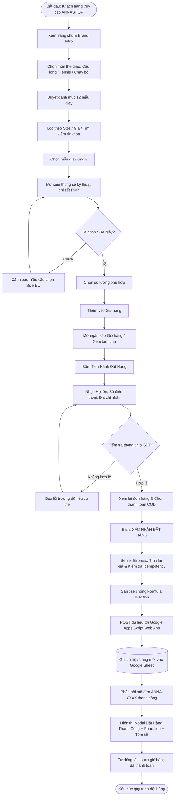

# BÁO CÁO ĐỀ TÀI MÔN HỌC: XÂY DỰNG WEBSITE THƯƠNG MẠI ĐIỆN TỬ ANNASHOP®
## CHỦ ĐỀ: NỀN TẢNG BÁN GIÀY THỂ THAO CAO CẤP TÍCH HỢP TỰ ĐỘNG HÓA GOOGLE SHEETS

---

### 1. GIỚI THIỆU DỰ ÁN
- **Tên thương hiệu:** ANNASHOP® — THE FUTURE OF MOTION
- **Khẩu hiệu:** "KHÔNG CHỈ LÀ CHUYỂN ĐỘNG. ĐÓ LÀ CÁCH BẠN BỨT PHÁ."
- **Môn học:** Thương Mại Điện Tử & Phát Triển Ứng Dụng Web
- **Công nghệ chính:**
  - Frontend: React 19 + TypeScript + Tailwind CSS v4 + Motion
  - Backend Relay: Node.js + Express (authoritative price validation & formula sanitization)
  - Cơ sở dữ liệu lưu trữ đơn hàng: Google Sheets API thông qua Google Apps Script Web App

---

### 2. SƠ ĐỒ QUY TRÌNH HOẠT ĐỘNG (MERMAID PROCESS FLOWCHART)

---

### 3. BA MÔN THỂ THAO VÀ DANH MỤC 12 SẢN PHẨM

#### A. CẦU LÔNG (BADMINTON) — Tốc độ, Linh Hoạt & Smash
1. `bmt-01`: **ANNA AERO-BLITZ PRO X** (3.650.000 ₫) — Đế Hexa-Grip cao su sống, tấm carbon trợ lực đập cầu.
2. `bmt-02`: **ANNA METEOR STRIKE 7** (2.890.000 ₫) — Khung Lateral-Claw chống lật cổ chân khi cứu cầu mép lưới.
3. `bmt-03`: **ANNA VORTEX FEATHERLIGHT** (2.450.000 ₫) — Trọng lượng siêu nhẹ 260g cho vị trí đánh đôi lưới.
4. `bmt-04`: **ANNA PHANTOM COURT SHADOW** (3.200.000 ₫) — Mũi giày bọc Tough-Skin chịu mài mòn rê chân.

#### B. TENNIS — Sân Cứng, Trượt Ngang & Vững Chãi
5. `tns-01`: **ANNA COURT-DOMINATOR ACE** (3.950.000 ₫) — Mũi giày bọc Drag-Shield, khung Dynawall sườn.
6. `tns-02`: **ANNA SPIN-MATRIX PRO** (3.450.000 ₫) — Lồng TPU 360 độ hạn chế biến dạng khi phanh gấp.
7. `tns-03`: **ANNA BASELINE KINETIC** (3.100.000 ₫) — Đệm khí Pod-Air bảo vệ đầu gối qua 3 séc đấu.
8. `tns-04`: **ANNA GLIDE-MASTER RUSH** (2.950.000 ₫) — Cổ chun ôm khít cổ chân ngăn cát bụi sân nện.

#### C. CHẠY BỘ (RUNNING) — Trợ Lực Carbon & Bứt Tốc Dặm Dài
9. `run-01`: **ANNA NITRO-VELOCITY ELITE** (4.690.000 ₫) — Đĩa Carbon muỗng cong, bọt truyền Nitơ hoàn trả 87% lực.
10. `run-02`: **ANNA INFINITY STRIDE 4D** (3.350.000 ₫) — Đệm kép Cloud-Max êm ái cho cự ly 5K - 15K hàng ngày.
11. `run-03`: **ANNA AERO-TEMPO SUB-3** (3.600.000 ₫) — Thiết kế khí động học Rocker cho buổi chạy Tempo.
12. `run-04`: **ANNA TERRA-APEX TRAIL X** (3.850.000 ₫) — Gai đế 5mm, màng chống nước và tấm chắn Rock-Shield.

---

### 4. CẤU TRÚC BẢNG DỮ LIỆU GOOGLE SHEETS (13 CỘT TIÊU CHUẨN)

| Cột | Tên Tiêu Đề Cột | Kiểu Dữ Liệu | Ví Dụ Mẫu |
|---|---|---|---|
| A | Order ID | Text | `ANNA-261014-K8L2` |
| B | Thời Gian Đặt Hàng | Datetime | `14/10/2026, 19:30:15` |
| C | Họ Tên Khách Hàng | Text (Sanitized) | `Nguyễn Văn An` |
| D | Số Điện Thoại | Text (Giữ số 0) | `'0987654321` |
| E | Địa Chỉ Giao Hàng | Text | `Số 12 Chùa Bộc, Đống Đa, Hà Nội` |
| F | Chi Tiết Sản Phẩm & Size | Text (Serialized) | `ANNA NITRO-VELOCITY ELITE (Size 42) x1` |
| G | Size Giày | Text / List | `42` |
| H | Số Lượng | Text / List | `1` |
| I | Đơn Giá (VND) | Text | `4.690.000 đ` |
| J | Tổng Tiền Đơn Hàng | Text | `4.690.000 đ` |
| K | Phương Thức Thanh Toán | Text | `COD (Thanh toán khi nhận hàng)` |
| L | Trạng Thái Đơn Hàng | Text | `Đã xác nhận (Mới)` |
| M | Ghi Chú Đơn Hàng | Text | `Giao trong giờ hành chính` |

---

### 5. HƯỚNG DẪN TRIỂN KHAI VÀ LIÊN KẾT GOOGLE SHEETS
1. **Bước 1:** Mở trình duyệt và truy cập [sheets.new](https://sheets.new) để tạo bảng tính mới.
2. **Bước 2:** Vào menu `Tiện ích mở rộng (Extensions)` → `Apps Script`.
3. **Bước 3:** Sao chép toàn bộ nội dung file `/google-apps-script/Code.gs` và dán vào.
4. **Bước 4:** Bấm **Triển khai (Deploy)** → **Tùy chọn triển khai mới (New deployment)**.
   - Loại triển khai: `Ứng dụng web (Web app)`
   - Mô tả: `ANNASHOP API v1`
   - Thực thi dưới tên: `Tôi (Me)`
   - Ai có quyền truy cập: `Bất kỳ ai (Anyone)` *(Rất quan trọng)*
5. **Bước 5:** Bấm **Triển khai**, cấp quyền và sao chép **URL ứng dụng web** (kết thúc bằng `/exec`).
6. **Bước 6:** Trên giao diện website ANNASHOP, bấm nút `Google Sheets API` trên thanh điều hướng hoặc ở cuối trang, dán URL vào và bấm `LƯU URL`.
7. **Bước 7:** Bấm nút `Gửi Đơn Thử Nghiệm Vào Sheet` để kiểm tra kết quả ngay lập tức trên bảng tính!

---

### 6. MA TRẬN KIỂM THỬ HỆ THỐNG (TESTING PLAN & CHECKLIST)

| STT | Kịch Bản Kiểm Thử | Dữ Liệu Đầu Vào | Kết Quả Mong Đợi | Trạng Thái |
|---|---|---|---|---|
| 1 | Tìm kiếm sản phẩm | Gõ từ khóa "Nitro" hoặc "Tennis" | Chỉ hiển thị các mẫu giày khớp tên/môn đấu | ĐẠT |
| 2 | Lọc theo môn thể thao | Chọn tab "Giày Cầu Lông" | Lọc đúng 4 mẫu giày cầu lông `bmt-01` đến `bmt-04` | ĐẠT |
| 3 | Lọc theo Size giày | Chọn nút "42" | Chỉ hiển thị các mẫu có size 42 trong kho | ĐẠT |
| 4 | Bắt buộc chọn size | Thêm vào giỏ khi chưa chọn size | Hiển thị thông báo đỏ yêu cầu chọn size | ĐẠT |
| 5 | Tách biệt size trong giỏ | Chọn cùng 1 mẫu nhưng size 41 và 42 | Giỏ hàng lưu thành 2 dòng riêng biệt | ĐẠT |
| 6 | Gộp cùng size | Thêm mẫu A size 42 hai lần | Giỏ hàng tăng số lượng lên 2 ở cùng dòng | ĐẠT |
| 7 | Lưu giỏ hàng LocalStorage | Thêm hàng rồi F5 tải lại trang | Giỏ hàng và số lượng vẫn nguyên vẹn | ĐẠT |
| 8 | Validate số điện thoại VN | Nhập "12345" hoặc chữ cái | Báo lỗi SĐT không hợp lệ chuẩn Việt Nam | ĐẠT |
| 9 | Chống gửi trùng lặp | Nhấn Xác Nhận liên tục 2 lần | Nút chuyển trạng thái loading, chặn double-post | ĐẠT |
| 10 | Chống Formula Injection | Nhập tên `=CMD|' /C calc'!A0` | Tự động thêm dấu `'` ở đầu, tránh lệnh Excel | ĐẠT |
| 11 | Ghi nhận Google Sheets | Đặt hàng thành công | Một dòng mới xuất hiện với đầy đủ 13 cột | ĐẠT |
| 12 | Hiển thị Modal Thành Công | Đặt hàng xong | Xuất hiện hiệu ứng pháo hoa, mã đơn ANNA-XXXX | ĐẠT |

---

### 7. KỊCH BẢN THUYẾT MINH TRÌNH DIỄN (WALKTHROUGH)
1. **0:00 - 0:30:** Giới thiệu Brand Intro và Hero Scene: Typography khổng lồ "BUILT TO MOVE BEYOND", tương tác Parallax chuột và 3D Layered Shoe.
2. **0:30 - 1:00:** Khám phá Section 03 "THE THREE WORLDS OF MOTION" với 3 môn thể thao Cầu Lông, Tennis, Chạy Bộ.
3. **1:00 - 1:30:** Trình diễn bộ công cụ tìm kiếm và bộ lọc đa chiều (Search, Category tabs, Size selector, Price range).
4. **1:30 - 2:00:** Mở Product Detail Page, kiểm tra tính năng đo size, bảng thông số cơ học và chọn size bắt buộc.
5. **2:00 - 2:30:** Thao tác thêm vào Giỏ hàng, kiểm tra tính năng tính toán tiền VND và ngăn kéo Cart Drawer mượt mà.
6. **2:30 - 3:00:** Điền biểu mẫu đặt hàng, kiểm tra tính năng validate số điện thoại Việt Nam, xác nhận đơn hàng và kiểm tra dữ liệu xuất hiện trực tiếp trên Google Sheets.
